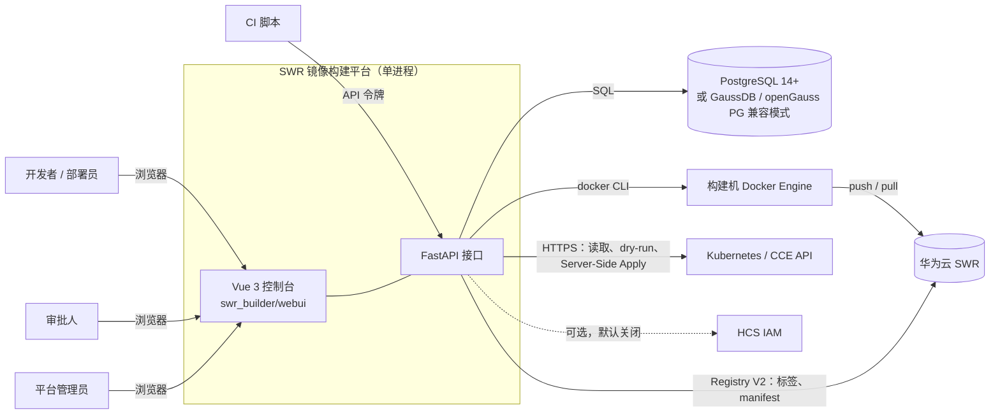
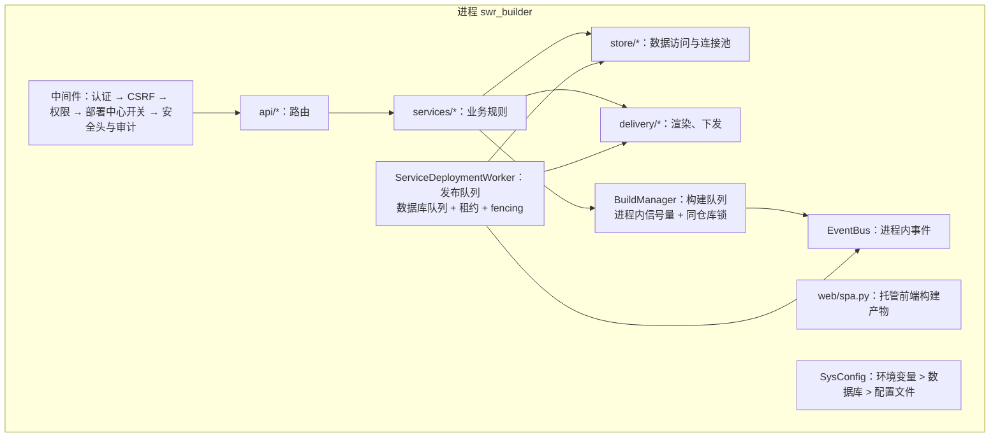
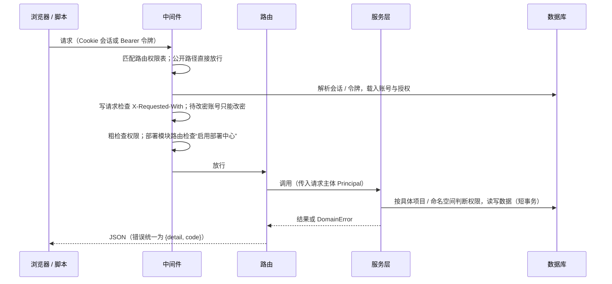
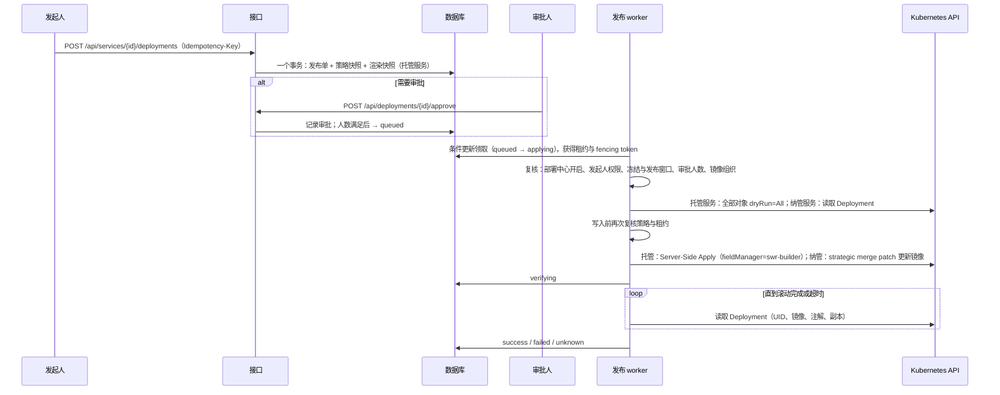
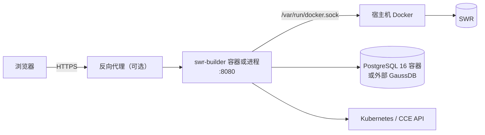

# SWR 镜像构建平台 系统架构

| 项目 | 内容 |
| --- | --- |
| 版本 | v2.0.0-dev.1（分支 `feature/v2-service-provisioning`） |
| 读者 | 后端、前端、运维开发人员，以及在本仓库工作的编码代理 |
| 相关文档 | 业务与功能设计见 [系统设计.md](系统设计.md)；托管服务与环境配置的设计取舍见 [v2-服务创建与环境配置设计.md](v2-服务创建与环境配置设计.md)；权限模型见 [账号与权限设计.md](账号与权限设计.md)；开发约定见 [开发文档.md](开发文档.md)；前端规范见 [DESIGN.md](../DESIGN.md) |

## 1. 系统定位

平台把“上传构建产物 → 构建镜像 → 推送 SWR → 发布到 Kubernetes 命名空间 → 查看运行状态”放在一个系统里：

- **构建**：上传 jar 等文件，平台自动识别上一版本，做累加或全量构建并推送到华为云 SWR。
- **交付**：在已纳管的命名空间中维护环境档案和分层配置，新建托管服务（平台按模板生成全部 Kubernetes 对象）
  或纳管已有 Deployment（只更新镜像），按审批策略发布、回滚。
- **运行**：读取集群中的 Deployment、Pod、事件等，显示服务的运行状态。

平台不创建集群或命名空间，不管理 Deployment 以外的工作负载，不做灰度发布和 GitOps 同步。

## 2. 系统上下文



| 外部系统 | 用途 | 凭据 |
| --- | --- | --- |
| PostgreSQL / GaussDB | 全部业务数据、发布队列 | `BUILDER_DATABASE_URL` + `BUILDER_DATABASE_PASSWORD` |
| Docker Engine | 构建与推送镜像（参数数组调用 docker CLI，不经过 shell） | 平台独立的 docker 配置目录 `data/docker-config/` |
| SWR | 读取标签和 manifest 判断上一版本；推送新版本 | `SWR_USERNAME` / `SWR_PASSWORD`（或 AK/SK） |
| Kubernetes / CCE | 集群发现、运行状态、服务端校验与下发 | 每个集群一份 kubeconfig 静态 Token 或客户端证书，加密保存 |
| HCS IAM | 保留的 AK/SK 换 Token 能力，发布不依赖它 | 配置文件或环境变量 |

## 3. 运行时组成

平台是一个 Python 进程（`python -m swr_builder`），组件由 `app.py` 的 `create_app()` 组装，放在 `AppContext`
（`app.state.ctx`）中，路由通过依赖注入取用。



| 组件 | 代码 | 说明 |
| --- | --- | --- |
| HTTP 层 | `web/middleware.py`、`web/permissions.py`、`web/guard.py`、`api/*` | 每个 `/api` 路由在定义处声明权限；中间件按声明做粗检查；未登记的 `/api` 路径一律拒绝 |
| 业务层 | `services/*` | 资源级权限判断、校验、事务编排；不依赖 FastAPI |
| 交付 | `delivery/*` | `spec`（托管规格与校验）、`render`（纯函数：输入 → 对象清单）、`resolve`（收集渲染输入与配置快照）、`apply`（Server-Side Apply 下发）、`importer`（分析 kubectl 导出，纯函数） |
| 数据层 | `store/*` | 按领域拆分的 mixin 组合成 `Store`；`store/db.py` 提供连接池、事务、保存点和约束识别 |
| 构建执行 | `builder.py`、`planner.py`、`registry.py`、`dockerfile.py`、`versioning.py` | 构建计划、Dockerfile 渲染、docker login / build / push、架构校验 |
| 发布执行 | `deploy/worker.py`、`deploy/k8s_client.py` | 从数据库领取发布单，写入 Kubernetes 并等待滚动完成 |
| 访问控制 | `access/catalog.py`、`access/principal.py` | 权限目录与内置角色的唯一定义处；每个请求计算一次请求主体 |
| 设置 | `config.py`、`sysconfig.py` | YAML 配置 + 数据库中的设置覆盖；部分字段可被环境变量锁定 |
| 安全 | `security.py`、`auth.py` | PBKDF2 口令、会话与 API 令牌、Fernet 加密（`secret.key` 或 `BUILDER_SECRET_KEY`） |
| HCS（可选） | `cloud/*` | AK/SK 签名换 Token，默认关闭 |

### 3.1 生命周期

启动（FastAPI lifespan）：

1. 连接数据库，按版本执行未应用的迁移（`store/migrations.py`）；GaussDB 检查必须是 PG 兼容模式。
2. 读取或生成加密主密钥；`SysConfig` 加载数据库中的设置。
3. 创建首个管理员（仅当没有账号时）；把重启前仍在执行的构建标记为失败，把执行中的发布标记为“结果待确认”（`unknown`）。
4. 启动构建管理器和发布 worker。

停止：取消构建、停止发布 worker（执行中的发布按是否已写入集群标记为 `cancelled` 或 `unknown`）、关闭 HTTP 客户端。

## 4. 代码分层与依赖方向

```
api ──► services ──► store
  │        │  └────► delivery ──► deploy.k8s_client
  │        └───────► deploy（集群读取、发布 worker 生命周期）
  └──► web（依赖注入、审计）       access ◄── services / deploy / web
deploy.worker ──► delivery、store、services.namespaces / services.releases（策略与审批计数）
```

规则：

- 路由只做参数解析、调用服务层、记审计、组装响应。业务规则写在 `services/`，抛 `errors.py` 中的 `DomainError` 子类
  或 `ValueError`（转换为 400）。
- SQL 只出现在 `store/`；服务层通过 `Store` 方法访问数据。
- `delivery/render.py`、`delivery/spec.py`、`delivery/importer.py` 是纯函数，不访问数据库和网络；`resolve.py`
  读取数据库，`apply.py` 通过 `KubeClient` 访问集群。`delivery` 中有几处函数内导入 `services.environments` /
  `services.namespaces` 的默认值，用来避免循环依赖。
- 写入集群只发生在发布 worker 中；接口里对集群只做读取和 `dryRun=All` 的服务端校验。
- `web/guard.py` 不依赖任何业务模块，`api/*` 可以放心导入。

## 5. 关键流程

### 5.1 请求处理



### 5.2 构建

上传 → 安全保存（去路径、限大小、zip 防穿越）→ 创建 `queued` 任务（保存应用快照）→ 进程内全局信号量 + 同仓库锁 →
重新解析上一版本 → 渲染 Dockerfile → `docker login`（口令走 stdin）→ `docker build` → 检查镜像架构 → `docker push` →
记录 digest → 发出 `build.succeeded` / `build.failed`。日志写在 `data/jobs/<任务ID>/build.log`，前端增量读取。
详细规则见 [系统设计.md](系统设计.md) §4。

### 5.3 发布



要点：

- 托管服务的发布单在提交时固定所用的配置版本（`deployment_manifests.inputs`），审批、下发、回滚都按这份快照渲染。
- 每个服务同一时刻只有一个执行中的发布（部分唯一索引 `uq_deployments_active_service`）。
- 每次读写集群前确认租约；状态更新都带 fencing token，过期的 worker 不能覆盖结果。
- 已开始写入集群后出错、或 worker 中途退出，结果标记为 `unknown`，需要人工核对，不自动重放。
- 系统设置关闭“启用部署中心”时：接口拒绝提交与审批；worker 不领取新任务，排队中的任务取消，
  已领取的任务在写入前停止。

### 5.4 导入已有服务

上传 kubectl 导出或直接读取集群 → `delivery/importer.py` 分析（纯函数，输出不含敏感值）→ 用户确认 →
`services/imports.py` 写入应用、服务、环境档案和各层配置（只写平台数据，不改集群）→ 每个服务做一次“接管发布”
（镜像沿用线上 digest），由 worker 按 §5.3 下发。

### 5.5 运行状态

`services/discovery.py` 用集群凭据读取 Deployment、ReplicaSet、Pod、HPA、Service、Ingress 和事件
（最多 1000 条命名空间事件，过滤出与服务相关的前 50 条），按 kubectl 的规则计算 Pod 状态，按 `rollout status`
的逻辑计算 Deployment 状态。服务列表的运行状态每个命名空间只读一次 Deployment 列表，并且只读取当前页的服务。
接口不返回凭据和 Pod 环境变量。

## 6. 数据架构

### 6.1 数据库

PostgreSQL 14+，或以 `DBCOMPATIBILITY 'PG'` 创建的 GaussDB / openGauss。驱动为 psycopg 3（GaussDB 使用 SHA256
认证时可改用华为 `gaussdb` 驱动），不使用 ORM。

| 分组 | 表 |
| --- | --- |
| 账号与权限 | `users`、`sessions`、`api_tokens`、`custom_roles`、`role_bindings`、`audit_logs`、`settings` |
| 构建 | `projects`、`project_registry_orgs`、`apps`、`jobs` |
| 集群与环境 | `clusters`、`namespaces`、`project_namespaces`、`environment_profiles`、`ingress_profiles` |
| 配置与证书 | `config_sets`、`config_set_versions`、`config_certificate_refs`、`certificates`、`certificate_versions` |
| 服务与发布 | `services`、`service_revisions`、`service_secrets`、`deployments`、`approvals`、`deployment_manifests` |
| 旧部署目标 | `deploy_targets`（只读核对与连接测试） |
| 迁移记录 | `schema_migrations` |

- 迁移：1 基线（等价于 v1.3 结构）、2 环境与配置、3 发布快照。迁移只追加，每个迁移一个事务，执行前锁住
  `schema_migrations`，多个实例同时启动只会执行一次；数据库中有程序不认识的更高版本时拒绝启动。
- SQL 只用两种数据库共有的语法：`BIGSERIAL` + `RETURNING`、保存点；不用 `ON CONFLICT`、`SKIP LOCKED`、IDENTITY、
  `MERGE`、聚合 `FILTER`、`LATERAL`、数据修改型 CTE。约束显式命名，按 SQLSTATE 与约束名识别冲突。
- 时间列为 `TIMESTAMPTZ`，会话时区 UTC，接口返回 ISO 8601 字符串；JSON 存为 `TEXT`，由 Python 编解码。
- 并发：修订号在服务行锁内生成；发布单用条件更新领取；审批计数时锁住发布单行；幂等创建以唯一约束为准。

### 6.2 文件

数据目录（默认 `./data`）：

| 路径 | 内容 |
| --- | --- |
| `jobs/<任务ID>/` | 构建上下文与 `build.log` |
| `deployments/<发布ID>/deploy.log` | 发布日志（凭据已脱敏） |
| `docker-config/` | 平台独立的 docker 登录信息 |
| `secret.key` | 加密主密钥（使用 `BUILDER_SECRET_KEY` 时不需要） |

数据库与 `secret.key` 必须一起备份：配置集中的敏感值、证书文件、集群凭据都用它加密。

## 7. 安全架构

| 方面 | 做法 |
| --- | --- |
| 认证 | 网页用随机会话令牌（HttpOnly、SameSite=Lax Cookie，数据库只存摘要）；脚本用 API 令牌（`Authorization: Bearer`）；登录失败锁定；首次登录与重置后强制改密 |
| CSRF | Cookie 会话的写请求必须带 `X-Requested-With: XMLHttpRequest` |
| 授权 | 权限只来自授权记录（全局 / 项目 / 命名空间三种范围）；路由声明 + 服务层按资源检查；无权访问的具体资源返回 404 |
| 发布控制 | 审批人与发起人分离；生产只认平台管理员；冻结与发布窗口在接口和 worker 中各检查一次；镜像必须固定 digest 且属于允许的 SWR 组织 |
| 集群写入 | 只在 worker 中；只覆盖平台声明的字段；不覆盖平台中其他服务的对象；不由平台管理的同名对象只在接管发布时接管 |
| 敏感数据 | Fernet 加密保存；接口、日志、渲染快照中不出现明文；查看明文需要 `secret.view` 并写审计 |
| kubeconfig | 只接受静态 Token 或内嵌客户端证书；不执行 `exec` / `auth-provider`，不读取外部文件 |
| 响应头 | CSP、`X-Frame-Options: DENY`、`nosniff`；`secure_cookie` 时加 HSTS；API 响应 `no-store` |
| 审计 | 登录、管理操作、发布提交与审批、查看敏感值都写 `audit_logs` |

## 8. 前端架构

- Vue 3 + TypeScript + Vite + Vue Router（history 模式）+ Pinia + Element Plus。源码在 `web/`，`npm run build`
  输出到 `swr_builder/webui/`，由 FastAPI 托管：`/assets/*` 长期缓存，其他页面路径回落到 `index.html`。
- 路由守卫处理登录、强制改密、权限（`meta.perms`）和部署中心开关（`meta.deploy`）；导航菜单由同一份路由表生成。
- `api/http.ts` 统一请求：带 `X-Requested-With`，401 跳登录并带回原地址，`PASSWORD_CHANGE_REQUIRED` 跳改密页，
  错误转换为带中文 `detail` 的异常；发布类请求生成幂等键。
- 状态：`session`（当前账号、权限判断、部署中心开关）、`catalog`（角色与权限目录）、`platform`（平台信息、应用缓存）、
  `preferences`（外观与侧栏）。
- 界面规范见 [DESIGN.md](../DESIGN.md)。

## 9. 部署架构



| 方式 | 说明 |
| --- | --- |
| 源码 | Python 3.11+，`pip install -r requirements.txt`，`python -m swr_builder -c config.yaml`；可配 systemd（`deploy/swr-builder.service`） |
| 容器 | `Dockerfile` 多阶段构建（先构建前端）；容器内只有 docker CLI，构建由宿主机 Docker 完成 |
| Compose | `deploy/docker-compose.yml`：平台 + 独立的 PostgreSQL 16 |
| 离线包 | `deploy/offline/`、`scripts/*arm64*`：v1.x 的 ARM64 离线交付；**尚未改为 PostgreSQL**，v2 暂不能用离线包交付 |

资源与上线检查见 README 第 3、7 节。

## 10. 可靠性与扩展性

- **单实例**：构建队列在进程内，构建 worker 和发布 worker 都按单进程设计；不支持多实例同时运行。
  数据层已支持多个连接并发访问，发布队列的租约与 fencing 也允许将来扩展为多实例。
- **构建**：全局并发上限（`build.max_concurrent`，默认 2）+ 同仓库串行；重启后未完成的构建标记失败，需要重新提交。
- **发布**：租约 5 分钟、每分钟续租；租约过期的执行中任务标记 `unknown` 并释放该服务的发布槽；
  审批 24 小时未完成自动过期。
- **数据库**：自带最小连接池，空闲超过 30 秒的连接复用前先检查；所有列表接口有界分页。
- **事件**：`EventBus` 是进程内回调，不是可靠消息队列；需要可靠通知时应接入外部队列。

## 11. 技术选型

| 选择 | 理由 |
| --- | --- |
| FastAPI + uvicorn | 异步 I/O 适合同时读取 SWR、Kubernetes；依赖注入便于测试替换 transport |
| psycopg 3，手写 SQL | GaussDB 兼容需要逐条控制 SQL；不引入 ORM 与迁移框架 |
| docker CLI | 与现场构建机一致，复用 Docker 的层缓存；参数数组调用，避免 shell 注入 |
| Server-Side Apply | API Server 记录字段归属，平台只覆盖自己声明的字段，CCE 写的字段保持不变 |
| Vue 3 + Element Plus | 管理后台组件齐全；TypeScript 严格模式在 CI 中检查 |

## 12. 演进

| 版本 | 变化 |
| --- | --- |
| v1.0–v1.1 | 构建平台：累加 / 全量构建、SQLite、原生 HTML 页面、账号与设置、部署适配器（Webhook / Kubernetes） |
| v1.2 | 项目与命名空间授权、服务修订、审批与持久化发布队列（纳管服务） |
| v1.3 | Vue 3 控制台、业务逻辑分层、统一的权限模型 |
| v2.0 | PostgreSQL / GaussDB；环境档案与分层配置、证书库；托管服务（模板、快照、Server-Side Apply）；导入与接管发布；服务运行状态 |
| 后续 | 配置变更的批量发布、线上字段漂移检测、离线包支持 PostgreSQL、多实例部署 |
