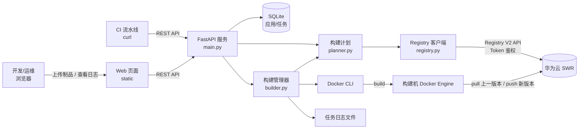
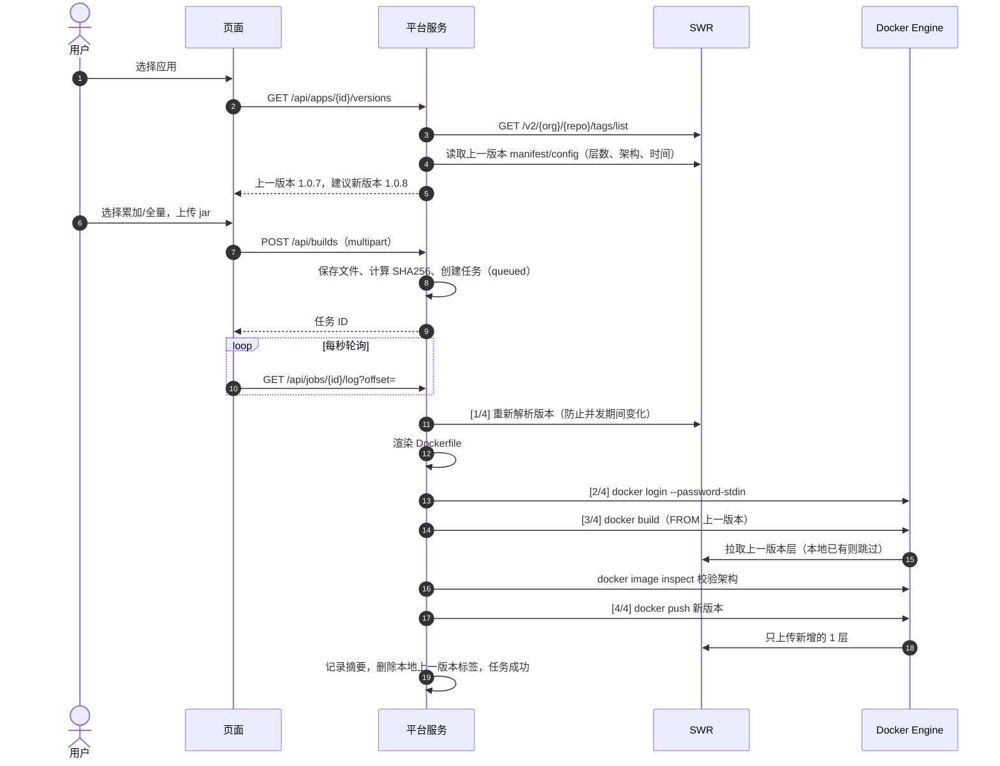
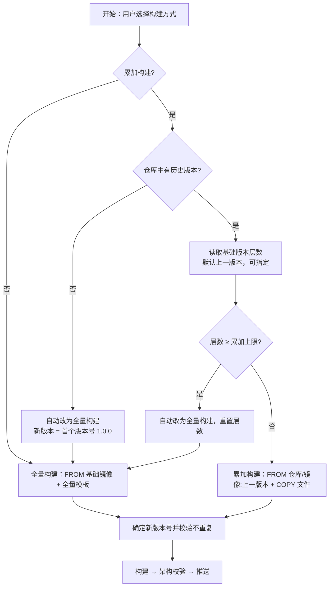
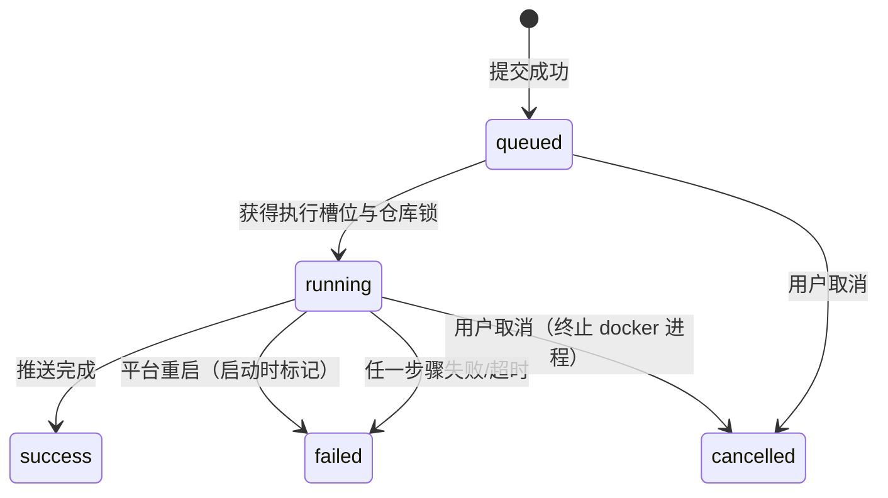
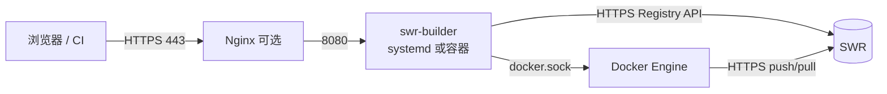

# SWR 镜像构建平台 系统设计文档

| 项目 | 内容 |
| --- | --- |
| 系统名称 | SWR 镜像构建平台（swr-image-builder） |
| 版本 | v1.1.1 |
| 目标仓库 | 华为云 Stack SWR：`swr.ndc302-region-1.huaweicloud.cnnc.cn`，组织 `metaerp-beta15` |
| 技术栈 | Python 3.11+ / FastAPI / SQLite / Docker CLI / 原生 HTML + JS |

## 1. 背景与目标

### 1.1 现状问题

当前每次发版需要人工：编写/修改 Dockerfile → 查询 SWR 上一版本号 → 手动 `docker build` → 手动 `docker push`。存在以下问题：

- 版本号靠人工查询和递增，容易重复或覆盖已有版本
- 每次都基于基础镜像全量构建，推送和拉取的数据量大
- 构建过程无记录，问题难以追溯
- 构建机是 x86、目标是 arm64 时，容易推送错误架构的镜像

### 1.2 建设目标

| 编号 | 目标 | 实现方式 |
| --- | --- | --- |
| G1 | 页面上传制品 | 浏览器拖拽上传 jar/war/zip/配置文件，显示上传进度 |
| G2 | 自动获取上一版本 | 调用 SWR Registry V2 接口列出标签，按版本号或推送时间确定上一版本 |
| G3 | 镜像累加 | 以上一版本镜像为基础（`FROM 上一版本`），只追加本次文件层 |
| G4 | 自动构建、推送 | 后台任务执行 `docker login / build / push`，实时日志 |
| G5 | 安全可控 | 不覆盖已有版本、层数保护、架构校验、凭证脱敏、平台登录 |
| G6 | 可追溯 | 记录操作人、上传文件及 SHA256、Dockerfile、基础版本、镜像摘要、完整日志 |

### 1.3 非目标（v1.1 不包含）

- 源码编译（制品由现有 CI/本地打包产生，平台只负责镜像化）
- 平台多实例 HA、自动创建集群、生产发布审批与自动回滚（已有工作负载镜像更新见第 14 节）

## 2. 术语

| 术语 | 说明 |
| --- | --- |
| 应用 | 一个应用对应 SWR 中的一个镜像仓库（组织/镜像名），并保存构建模板 |
| 上一版本 | 仓库中最新的版本标签（排除 `latest` 等非版本标签） |
| 累加构建（incremental） | `FROM 上一版本镜像` + `COPY 本次文件`，每次只新增 1 层 |
| 全量构建（full） | `FROM 基础镜像` + 应用全量模板（来自原 Dockerfile） |
| 基础镜像 | 全量构建使用的镜像，如 `metaerp_sdk/java:8-huawei-r30-arm64` |
| 登录密钥 | `docker login` 使用的 SWR 长期有效登录密钥（明文）或由 AK/SK 计算 |

## 3. 总体架构



部署形态：平台与 Docker 部署在同一台构建机上（systemd 直接运行，或容器挂载 `/var/run/docker.sock`），单进程运行。

## 4. 核心业务流程

### 4.1 构建主流程



### 4.2 构建方式决策



### 4.3 任务状态



执行步骤 `step`：`queued → resolve（解析版本）→ login（登录仓库）→ build（构建+架构校验）→ push（推送）→ done`。

## 5. 模块设计

| 模块 | 文件 | 职责 |
| --- | --- | --- |
| 配置 | `config.py` | 读取 `config.yaml`，环境变量覆盖敏感项；AK/SK → 登录密钥计算 |
| 仓库客户端 | `registry.py` | Docker Registry V2：Bearer/Basic 挑战鉴权、Token 缓存、标签分页、manifest（含多架构 manifest list 选择）、config blob（层数/大小/架构/创建时间） |
| 版本规则 | `versioning.py` | 标签合法性、版本排序、上一版本判定、新版本号递增、标签模板 |
| Dockerfile | `dockerfile.py` | 模板渲染、上传文件放置规划、zip 安全解压、导入已有 Dockerfile |
| 应用 | `apps.py` | 应用字段默认值与校验 |
| 构建计划 | `planner.py` | 计算上一版本、实际构建方式、基础镜像、新版本号、期望架构；预览与构建共用 |
| 构建管理 | `builder.py` | 任务调度、并发控制、执行 docker 命令、日志、取消、超时、清理 |
| 存储 | `store.py` | SQLite（WAL）持久化应用与任务 |
| Web/API | `main.py` + `static/` | REST 接口、上传处理、会话 / API Token 认证、RBAC、登录及管理页面 |

### 5.1 上一版本判定

1. `GET /v2/<组织>/<镜像>/tags/list?n=1000`，按 `Link` 头分页读取全部标签；仓库不存在返回空列表（首次构建）
2. 过滤：排除 `latest`；如配置了“标签过滤正则”/“标签模板”则只保留匹配的标签
3. 判定方式（应用可配）：
   - `version`（默认）：按版本号自然排序取最大，`1.0.10 > 1.0.9`，`1.0.9-arm64` 按数字段比较
   - `time`：读取各标签镜像 config 中的 `created`，取最近推送的（标签多时较慢）

### 5.2 新版本号规则

| 上一版本 | 新版本 | 说明 |
| --- | --- | --- |
| （无） | `1.0.0` | 使用应用的“首个版本号” |
| `1.0.7` | `1.0.8` | 递增最后一个独立数字段 |
| `1.0.9-arm64` | `1.0.10-arm64` | 后缀保留 |
| `v12` | `v13` | 前缀保留 |
| 模板 `{date}.{seq}` | `20250101.3` | 支持日期 + 当日序号 |

- 用户可手动指定版本号；**已存在的版本号一律拒绝**（平台不覆盖任何已有版本）
- 自动生成的版本号如与已有标签冲突会继续递增

### 5.3 Dockerfile 模板

支持变量：`{{BASE_IMAGE}}`、`{{COPY_FILES}}`、`{{TARGET_DIR}}`、`{{NEW_TAG}}`、`{{PREV_TAG}}`、`{{IMAGE}}`。

累加模板（默认）：

```dockerfile
FROM {{BASE_IMAGE}}        # = swr.../metaerp-beta15/cnnc-coding-chc-fin:1.0.7
{{COPY_FILES}}             # = COPY --chown=nonroot:nonroot ["files/", "/app/"]
```

全量模板（由附件 Dockerfile 导入）：

```dockerfile
FROM {{BASE_IMAGE}}        # = swr.../metaerp_sdk/java:8-huawei-r30-arm64
MAINTAINER FAN
WORKDIR /app
{{COPY_FILES}}
EXPOSE 8080
CMD ["-jar","/app/cnnc-coding-chc-fin.jar"]
```

累加构建只追加文件层，`WORKDIR`、`EXPOSE`、`CMD`、`ENTRYPOINT`、环境变量等全部继承上一版本；需要修改这些配置时使用全量构建。

**导入 Dockerfile**：解析 `FROM`（基础镜像）、最后一个 `WORKDIR`（目标目录）、`COPY/ADD` 的目标文件名与 `--chown`，并将该 COPY 行替换为 `{{COPY_FILES}}` 生成全量模板；支持 CRLF、续行、注释，识别镜像名中的 arm64 并提示设置构建平台。

### 5.4 上传文件放置

构建上下文结构：`data/jobs/<任务ID>/context/{Dockerfile, files/...}`，`COPY ["files/", "<目标目录>/"]` 一次复制全部文件（只产生 1 层）。

| 场景 | 规则 | 示例 |
| --- | --- | --- |
| 单文件 + 配置了目标文件名 | 重命名 | `cnnc-coding-fin-1.0.0-SNAPSHOT.jar → /app/cnnc-coding-chc-fin.jar` |
| 多个文件 | 保留原文件名 | `a.jar、application.yml → /app/` |
| zip 勾选解压 | 按目录结构合并 | `lib/x.jar → /app/lib/x.jar` |

文件名做安全处理（去除路径、禁止 `..`、重名检测），zip 解压防路径穿越、限制解压后总大小，兼容 GBK 文件名。

### 5.5 层数保护

- Docker（overlay2）单镜像层数上限约 127 层，超过后构建/运行报 `max depth exceeded`
- 累加构建每次新增 1 层：构建前读取基础版本层数，**达到“累加层数上限”（默认 100）时自动改为全量构建**，并在日志中提示
- 被覆盖的旧 jar 仍在下层占用空间，建议每 20~30 个版本主动做一次全量构建

### 5.6 架构校验

- 期望架构：应用配置的“构建平台”（如 `linux/arm64`）优先；否则取基础镜像（上一版本或基础镜像）的架构
- 构建时传 `--platform`（如配置），构建后 `docker image inspect` 读取 `Os/Architecture`，**不一致则终止，不推送**
- x86 构建机构建 arm64 镜像：累加模板只有 `FROM` + `COPY`，不需要 qemu；模板中包含 `RUN` 时需在构建机安装 binfmt/qemu

## 6. 数据设计

SQLite 文件 `data/builder.db`，WAL 模式。

### 6.1 应用表 apps

| 字段 | 类型 | 说明 |
| --- | --- | --- |
| id | INTEGER PK | 自增 |
| name | TEXT UNIQUE | 应用名称 |
| data | TEXT(JSON) | 应用配置，见下表 |
| created_at / updated_at | TEXT | ISO8601 时间 |

应用配置（data）：

| 字段 | 默认值 | 说明 |
| --- | --- | --- |
| organization | 空（用全局组织） | SWR 组织 |
| repository | — | 镜像名，如 `cnnc-coding-chc-fin` |
| base_image | — | 全量/首次构建的基础镜像 |
| default_mode | incremental | 默认构建方式 |
| target_dir / target_name / chown | /app / 空 / 空 | 文件放置目录、单文件重命名、属主 |
| platform | 空 | 目标平台，如 `linux/arm64` |
| latest_strategy | version | 上一版本判定：version / time |
| tag_regex / tag_template / initial_tag | 空 / 空 / 1.0.0 | 标签过滤、版本模板、首个版本号 |
| max_layers | 100 | 累加层数上限（0 不限制） |
| push_latest | false | 是否同时推送 latest |
| full_template / incremental_template | 见 5.3 | Dockerfile 模板 |

### 6.2 任务表 jobs

| 字段 | 说明 |
| --- | --- |
| id, app_id, app_name, repository | 任务与应用、镜像仓库 |
| requested_mode / requested_tag / requested_base_tag | 用户请求的构建方式、版本号、基础版本 |
| mode, prev_tag, base_tag, base_image, new_tag, image, digest | 实际执行结果：构建方式、上一版本、基于版本、FROM 镜像、新版本、完整镜像地址、推送摘要 |
| status, step | 状态（queued/running/success/failed/cancelled）与当前步骤 |
| operator, remark | 操作人（启用登录时取登录用户）、备注 |
| files (JSON) | 上传文件：原名、目标路径、大小、SHA256、解压条目 |
| notes (JSON) | 自动切换全量等提示 |
| app_snapshot (JSON) | 提交时的应用配置快照（构建期间修改应用不影响该任务） |
| dockerfile, error | 实际使用的 Dockerfile、失败原因 |
| created_at, started_at, finished_at | 时间 |

### 6.3 文件存储

| 路径 | 内容 | 清理策略 |
| --- | --- | --- |
| `data/jobs/<id>/build.log` | 完整构建日志（密钥脱敏） | 保留，可按需定期清理 |
| `data/jobs/<id>/context/` | 上传文件 + Dockerfile | 构建结束删除（`keep_context: true` 时保留） |
| `data/docker-config/` | 平台独立的 docker 登录信息 | 不影响构建机其他用户 |
| `data/tmp/` | 上传临时文件 | 请求结束自动删除 |

## 7. 接口设计

| 方法 | 路径 | 说明 |
| --- | --- | --- |
| GET | `/healthz` | 健康检查（免登录） |
| GET | `/api/info` | 版本、仓库配置状态、Docker 版本与架构、当前用户 |
| POST | `/api/registry/test` | 测试 SWR 连接与鉴权 |
| GET | `/api/app-defaults` | 应用默认配置 |
| GET / POST | `/api/apps` | 应用列表 / 新建 |
| PUT / DELETE | `/api/apps/{id}` | 修改 / 删除 |
| POST | `/api/dockerfile/import` | `{"text": "..."}` → 基础镜像、目录、文件名、属主、全量模板、提示 |
| GET | `/api/apps/{id}/versions` | 全部标签（倒序）、上一版本及详情、建议版本号 |
| POST | `/api/apps/{id}/preview` | `{mode, base_tag, tag, filenames, extract_zip}` → 构建计划 + Dockerfile + 文件放置 |
| POST | `/api/builds` | multipart：`app_id, mode, tag, base_tag, operator, remark, extract_zip, files[]` → `{id}` |
| GET | `/api/jobs?app_id=&status=&limit=&offset=` | 构建记录 |
| GET | `/api/jobs/{id}` | 任务详情 |
| GET | `/api/jobs/{id}/log?offset=` | 增量日志 `{text, offset, status, step, finished}` |
| POST | `/api/jobs/{id}/cancel` | 取消任务 |

错误统一返回 HTTP 4xx/5xx + `{"detail": "中文错误信息"}`；仓库不可达/鉴权失败返回 502。

## 8. 调度与并发

- **全局并发**：信号量控制同时构建数（`build.max_concurrent`，默认 2）
- **同仓库串行**：每个镜像仓库一把锁，保证“读取上一版本 → 推送新版本”原子化，避免两个任务算出相同版本号或基于同一旧版本
- **执行时重新解析**：版本在任务真正执行时重新计算（页面上显示的只是预估），排队期间别人推送的新版本也会被正确累加
- **超时**：login 120s、build 1800s、push 1800s（可配置），超时终止进程并标记失败
- **取消**：排队中直接取消；运行中终止 docker 子进程
- **重启恢复**：启动时将未完成任务标记为“平台重启，任务被中断”
- **单进程**：队列和锁在进程内存中，不能多 worker 运行（见第 12 章扩展）

## 9. 安全设计

| 风险 | 措施 |
| --- | --- |
| 仓库凭证泄露 | 凭证建议通过环境变量/600 权限 env 文件注入；`docker login --password-stdin` 不出现在进程参数；日志中密钥/SK 自动替换为 `******`；接口只返回脱敏用户名 |
| 影响构建机其他用户 | 使用独立 `DOCKER_CONFIG` 目录保存登录信息 |
| 未授权访问 | 强制平台登录（HttpOnly Cookie / API Token）、RBAC、改密、会话撤销、失败锁定；生产需 HTTPS 并限制网络来源 |
| 覆盖线上版本 | 已存在的标签禁止构建；默认不推送 latest |
| 恶意上传 | 文件名净化、zip 路径穿越防护、上传与解压大小限制、构建上下文按任务隔离 |
| 模板注入 | 模板变量白名单校验，必须包含 `FROM` 与 `{{COPY_FILES}}`；镜像名/组织/属主/平台格式校验 |
| 错误架构上线 | 构建后架构校验，不一致不推送 |
| TLS | 默认校验证书，支持自定义 CA 文件；仅在必要时开启 `insecure` |

> 注意：能访问 Docker 的进程等同于构建机 root 权限，平台应部署在专用构建机并限制访问来源。

## 10. 部署设计

### 10.1 部署拓扑



### 10.2 资源建议

| 资源 | 建议 | 说明 |
| --- | --- | --- |
| CPU / 内存 | 2C / 4G 起 | 平台本身占用很小，主要是 Docker 构建 |
| 磁盘 | 100G+ | 本地镜像缓存；推送成功后会删除本地上一版本标签 |
| 架构 | arm64 构建机优先 | x86 需设置构建平台 |
| 网络 | 构建机 → SWR 443 | 防火墙/代理放通 |

### 10.3 部署方式

- **systemd**：`deploy/swr-builder.service`，运行用户加入 docker 组，凭证放 `/opt/swr-builder/swr-builder.env`
- **容器**：根目录 `Dockerfile`（Python 3.11 + docker 静态 CLI），挂载 `docker.sock`、`config.yaml`、`data/`；或 `deploy/docker-compose.yml`
- **Nginx**：`client_max_body_size` ≥ 上传上限，`proxy_read_timeout` ≥ 600s

### 10.4 上线检查清单

1. 构建机执行 `docker login swr.ndc302-region-1.huaweicloud.cnnc.cn -u <用户名> -p <登录密钥>` 成功
2. 构建机能 `docker pull swr.ndc302-region-1.huaweicloud.cnnc.cn/metaerp_sdk/java:8-huawei-r30-arm64`
3. 页面顶部 SWR、Docker 状态为绿色；“应用管理”中测试仓库连接成功
4. 先用全量构建推送一个测试版本，再用累加构建验证版本递增与层数 +1

## 11. 异常处理

| 场景 | 平台行为 | 用户提示 |
| --- | --- | --- |
| 仓库不存在（首次） | 标签为空，自动全量构建，版本 1.0.0 | 日志提示“自动改为全量构建” |
| 鉴权失败 | 任务失败 | “SWR 鉴权失败：需要长期有效登录密钥” |
| 读取上一版本详情失败 | 不阻断，跳过层数检查 | 日志 WARN |
| 版本号已存在 | 拒绝 | “版本已存在，平台不会覆盖” |
| 层数达上限 | 自动全量；无基础镜像则失败 | 提示配置基础镜像 |
| docker 不可用 | 任务失败 | “找不到 docker 命令/没有权限” |
| build/push 失败或超时 | 任务失败，保留日志 | 显示退出码与日志 |
| 架构不一致 | 不推送 | 提示设置构建平台 |
| 推送 latest 失败 | 任务失败（新版本已推送） | 明确提示版本已推送 |
| 平台重启 | 未完成任务标记失败 | “平台重启，任务被中断” |

## 12. 扩展规划

| 方向 | 说明 |
| --- | --- |
| 统一认证 | 对接 LDAP/OAuth2/企业 SSO，按应用授权 |
| 多实例 | 任务队列改为 Redis/数据库队列 + 分布式锁，SQLite 换 MySQL/PostgreSQL |
| CI 集成 | 已提供 REST 接口；可增加构建完成 Webhook、Jenkins 插件 |
| 多仓库 | 支持多个 SWR 区域/组织凭证，跨区域同步 |
| 质量门禁 | 推送前镜像安全扫描、镜像签名 |
| 版本治理 | 自动清理旧标签、定期全量构建提醒、镜像体积趋势 |
| 发布联动 | 推送成功后触发 CCE/K8s 滚动更新 |

## 13. 测试方案

- **单元测试**：版本递增/排序、AK/SK 登录密钥计算、Dockerfile 导入（含 CRLF）
- **端到端测试**（`tests/`，不依赖真实仓库）：模拟 SWR（Token 鉴权、标签分页、manifest、跨域 blob 重定向）+ 假 docker，覆盖：
  - 导入 Dockerfile → 创建应用 → 读取上一版本 1.0.7 → 预览 → 累加构建推送 1.0.8 → 再次构建 1.0.9
  - 全量构建、指定版本号/基础版本、重复版本号拒绝
  - 架构不一致不推送、层数达上限自动全量、空仓库首次构建 + zip 解压、登录失败、参数校验
- 运行：`pip install -r requirements-dev.txt && pytest -q`


## 14. v1.1 账号、设置与部署设计

### 14.1 模块分层

- `security.py`：PBKDF2-SHA256 密码哈希、随机会话及 API 令牌、敏感值加密与完整性校验。
- `auth.py`：账号初始化、首次改密、会话、API Token、失败锁定与固定角色权限。
- `sysconfig.py`：设置元模型、校验、环境变量锁定、秘密值脱敏、数据库持久化、监听配置变化及失败恢复。
- `routes.py`：账号、系统、部署、HCS 测试 API；`main.py` 的统一中间件执行认证与权限控制，不依赖前端按钮隐藏。
- `events.py`：进程内构建/部署事件；处理失败不反向改变已成功的构建。
- `deploy/`：协议、注册表、目标管理、任务和日志；Webhook 与 Kubernetes 适配器已实现，SSH 占位。
- `cloud/hcs.py`：Huawei Cloud Stack 认证/只读连接层，具体管理 API 仍为扩展点。

### 14.2 账号与安全

固定角色为管理员、开发者、只读用户。开发者可构建、取消自己的任务并执行部署；只读用户仅查看；管理员管理系统、账号和目标。暂不支持应用级 ACL、SSO 或发布审批。

账号密码以 PBKDF2-SHA256（200000 次迭代、随机盐）存储；会话和 API Token 只保存 SHA256 摘要。会话 Cookie 使用 HttpOnly / SameSite=Lax，生产通过配置开启 Secure；Cookie 修改请求必须包含 X-Requested-With。Token 继承账号实时角色，禁用账号立即失效。

首次无账号时迁移旧 server.users（要求改密），否则创建 admin；未指定密码则随机生成、写 0600 初始密码文件，不输出日志。重置密码后强制改密并撤销会话和全部 API 令牌；用户自己改密保留当前会话、撤销其他会话及全部 API 令牌。禁止管理员自删、自停用或自行更改角色，至少保留一个启用的管理员。

失败锁定按用户名与客户端 IP 维护，当前在进程内，重启清空，不是分布式防暴力破解方案。IP 来自实际连接，不盲目信任用户提供的转发头。应在可信反向代理设置限流和访问控制。

### 14.3 数据与设置

新增 users、sessions、api_tokens、settings、audit_logs、deploy_targets、deployments 表，jobs 增加 created_by。升级为追加迁移，保留历史应用、任务与日志。

设置优先级：环境变量 > 数据库覆盖 > YAML / 默认值。密码、AK/SK、部署凭证与 IAM 秘密值加密保存，前端只返回空值及 is_set / secrets_set 状态；留空不修改，清空需明确选择。敏感配置使用 cryptography.Fernet 认证加密（新保存格式 enc:v2），主密钥在 0600 的 secret.key 或 BUILDER_SECRET_KEY；兼容读取早期开发数据 enc:v1。需要合规密钥管理的环境可继续接入企业 KMS。

凭证加密仅防止单独泄漏数据库时直接读取；主机或主密钥被攻破不受此保护。数据库与主密钥需一起备份；本版本没有自动轮换。服务器启动参数和数据目录仍由 YAML / 环境变量维护。

有排队或运行构建时禁止修改仓库和构建参数；其他设置仅影响后续操作，不回溯缩短已有会话有效期。设置监听重建 Registry 客户端、调整空闲构建并发，失败时恢复运行配置，不改写 YAML。

### 14.4 部署流程与边界

服务发布选择所属应用的成功构建和不可变 revision，固定镜像 digest，经 namespace policy 与审批后进入持久队列；worker 在 Kubernetes I/O 前复核发起人权限、冻结/部署窗口、审批数和镜像组织。

- Webhook：POST 签名 JSON，2xx 为“已接受”，不是工作负载就绪；测试发送 ping。接收端应鉴权并按 deployment_id 去重，异步回调与完整防重放协议尚未实现。
- Kubernetes：GET 已有 Deployment，校验容器存在，strategic merge PATCH 镜像与部署编号注解；可检查 observedGeneration 和副本状态等待 rollout；并发外部变更导致失败，不自动回滚。需独立配置 imagePullSecrets 和最小权限 ServiceAccount。
- SSH/Compose：available=false，仅协议占位。
- namespace 冻结支持带时区的截止时间；部署窗口使用 IANA 时区和 ISO 星期编号 1–7，跨午夜区间归属开始日。入队与 worker 执行前均检查，队列等待时策略变更会在外部写入前拦截。
- 回滚请求引用历史成功构建与 revision；不会回滚外部配置、数据库迁移或外部依赖。

目标在排队或运行部署时禁止编辑/删除；任务使用提交时目标快照。平台重启后将未结束部署标记失败/状态未知，不自动重试，以免重复变更。

### 14.5 API 补充

| 范围 | 路径 |
| --- | --- |
| 登录 | /api/auth/config、/login、/api/auth/login、/api/auth/logout、/api/auth/me |
| 个人账号 | /api/account/profile、/api/account/password、/api/account/sessions、/api/account/tokens |
| 账号管理 | /api/users、/api/users/{id}/reset-password、/api/roles |
| 设置 / 审计 | /api/settings、/api/settings/registry/test、/api/audit、/api/system |
| 部署目标 | /api/deploy/providers、/api/deploy/targets、/api/deploy/targets/{id}/test |
| 部署任务 | /api/deployments、/api/deployments/{id}、/api/deployments/{id}/log |
| HCS 接口预留 | /api/cloud/hcs/test、/api/cloud/hcs/capabilities |

## 15. 华为云 Stack 8.5.1 接入设计

**已实现 AK/SK 签名调用 POST /v3/auth/tokens 的客户端流程，默认使用 AK/SK，不再只预留。** `cloud/signing.py` 调用华为官方 SDK 签名器，`cloud/hcs.py` 发送真实 HTTP 请求并处理 Token；未连接用户真实环境，仍需现场验收。

### 15.1 请求与凭证

显式配置 IAM Endpoint；不从 SWR 地址推断。使用 SDK-HMAC-SHA256 / Access 格式签名，覆盖实际发送的请求体、Host/端口、UTC 时间和作用域头。项目级 Token 要求 project_id，账号级要求 domain_id；临时凭证可带 X-Security-Token。

默认零字节空请求体、作用域通过签名头传入；现场网关要求 JSON 时显式配置 aksk_request_body 模板，不编造 identity 方法。SK 只在本地参与签名，不作为密码、请求头或请求体发送。旧式 Credential 签名未实现，不能假设与当前 SDK Access 格式可直接互换。

### 15.2 生命周期与错误策略

必须有 200/201、X-Subject-Token 和有效 token 对象；检查 expires_at、项目/账号 ID，错误或不匹配不缓存。并发认证合并，缓存提前 60 秒失效；缺少过期时间不复用缓存。只读服务 GET 遇到 401 最多重新取 Token 并重试一次，不无限重试、不自动重放资源写操作。

禁止跟随重定向转发凭证；认证失败不自动回退密码。页面候选测试不保存配置，响应和日志不返回 Token 或 AK/SK；CLI `python -m swr_builder.cloud -c config.yaml` 可用于现场诊断，结果不含秘密值。

### 15.3 实现及待联调边界

本版 53 项自动化测试通过，包括官方 SDK 固定签名向量、独立模拟 IAM 签名校验、临时凭证、JSON 模板、Token 缓存/刷新和错误分支。不代表真实 Stack 环境已联通；需要确认现场网关请求体及签名兼容性、网络、CA、时间同步和权限。

SWR Registry、HCS IAM 和 Kubernetes 原生 API 使用独立凭证域。SWR/CCE/ECS 管理面业务接口、ManageOne SSO、审批及自动回滚仍为后续工作。详细配置、证据范围、协议差异和故障排查见《华为云Stack8.5.1接口接入设计.md》。
