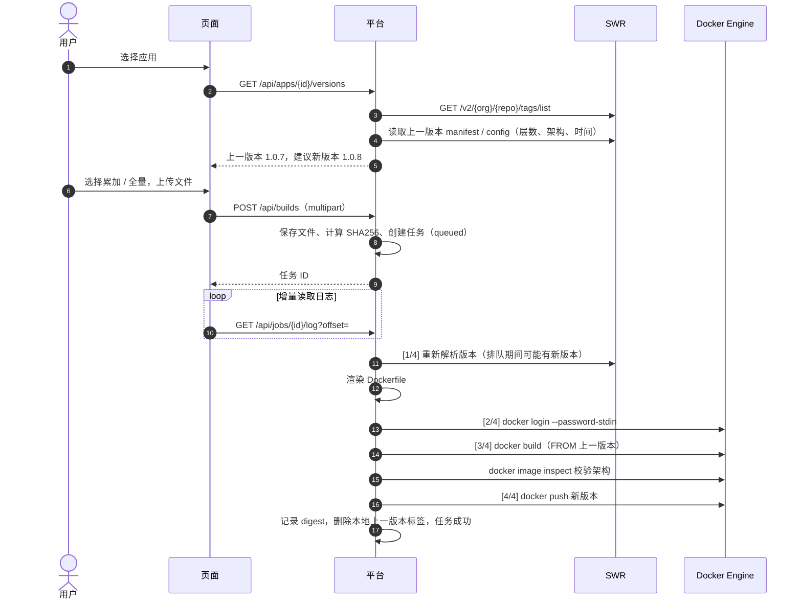
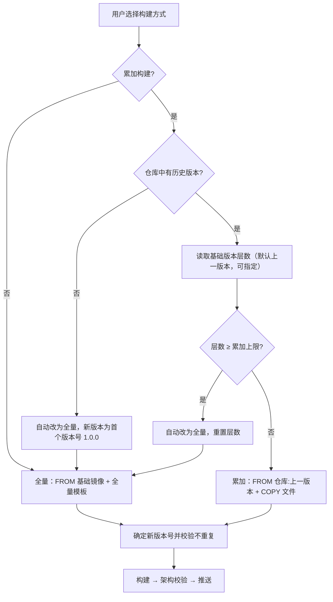
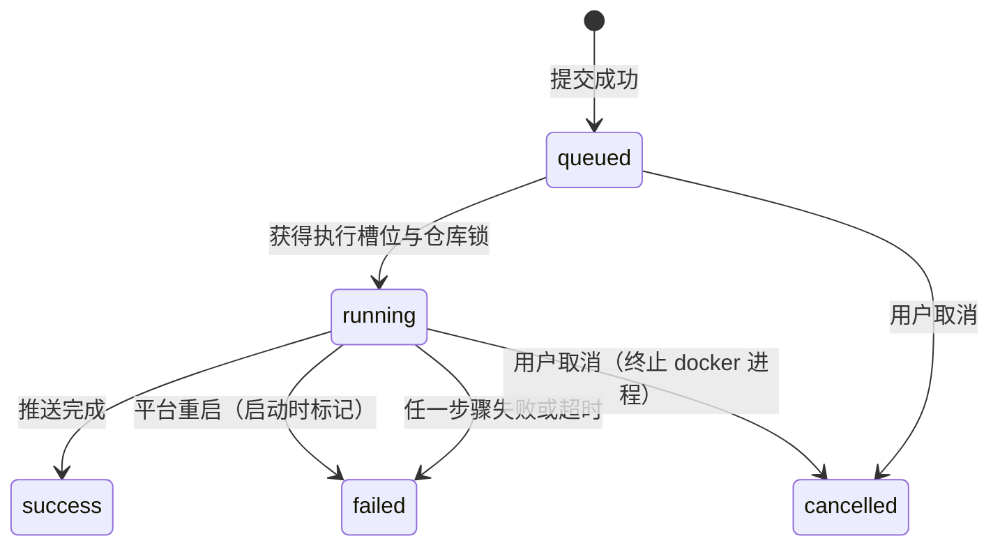
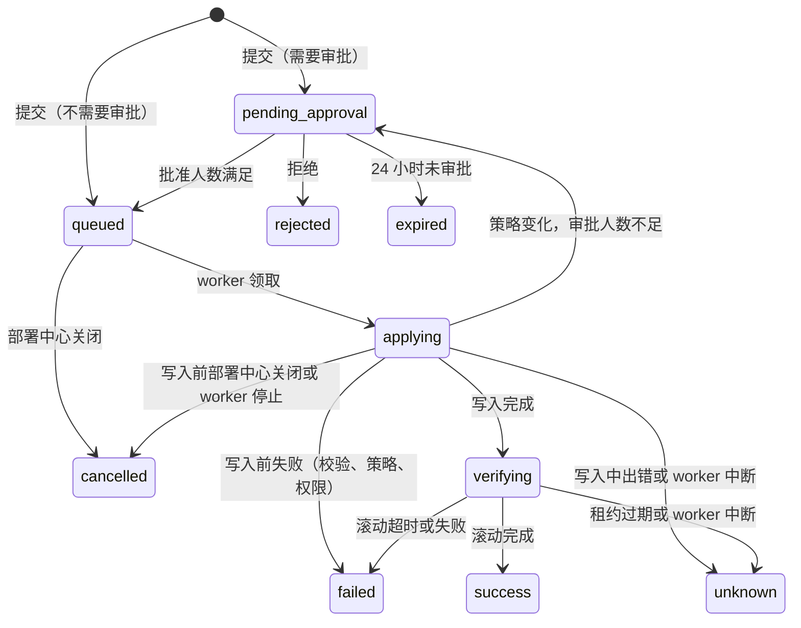

# SWR 镜像构建平台 系统设计

| 项目 | 内容 |
| --- | --- |
| 系统名称 | SWR 镜像构建平台（swr-builder） |
| 版本 | v2.0.0-dev.1（v1.1.1 的构建设计保留在第 4 章） |
| 技术栈 | Python 3.11+ / FastAPI / PostgreSQL 14+ 或 GaussDB（PG 兼容模式）/ Docker CLI / Vue 3 + Element Plus |
| 目标环境 | 华为云 Stack 的 SWR 与 CCE（Kubernetes），也适用于标准 Kubernetes |

本文说明平台做什么、业务规则是什么。运行时结构见 [系统架构.md](系统架构.md)；v2 的方案比较与决定记录见
[v2-服务创建与环境配置设计.md](v2-服务创建与环境配置设计.md)；权限模型见 [账号与权限设计.md](账号与权限设计.md)；
开发约定见 [开发文档.md](开发文档.md)；前端规范见 [DESIGN.md](../DESIGN.md)。

## 1. 背景与目标

### 1.1 要解决的问题

构建（v1）：

- 版本号靠人工查询和递增，容易重复或覆盖已有版本。
- 每次都基于基础镜像全量构建，推送和拉取的数据量大。
- 构建过程没有记录，问题难以追溯；x86 构建机容易推送错误架构的 arm64 镜像。

交付（v2）：

- 服务只能“纳管”已有的 Deployment：新服务要先在 CCE 控制台手工创建 Deployment、Service、Ingress、ConfigMap、Secret，
  再回到平台登记。
- 证书和公共配置复制在每个服务自己的对象里，同一个参数改一处要逐个服务改。
- 服务页面看不到 Pod 状态、重启、事件，排查问题要另开控制台。
- 数据保存在 SQLite，只能单进程访问，不便于用独立数据库运维。

### 1.2 目标

| 编号 | 目标 | 实现方式 |
| --- | --- | --- |
| G1 | 页面上传制品构建镜像 | 上传 jar / war / zip / 配置文件，显示进度与实时日志 |
| G2 | 自动确定版本 | 读取 SWR 标签确定上一版本，自动递增，不覆盖已有版本 |
| G3 | 累加构建 | `FROM 上一版本` + 本次文件，每次只新增 1 层；层数达上限自动全量 |
| G4 | 安全可追溯 | 架构校验、凭证脱敏、记录操作人、文件摘要、Dockerfile、镜像 digest |
| G5 | 在平台内新建服务 | 按模板生成 Deployment、Service、Ingress、HPA 与配置对象，提交前预览并做服务端校验 |
| G6 | 环境配置只维护一次 | 平台 → 项目 → 环境 → 服务四层配置，证书集中管理，每次修改生成版本 |
| G7 | 已有服务可迁入 | 分析 kubectl 导出或集群对象，把共有参数放到环境层，确认后由平台接管 |
| G8 | 发布可控 | 发布单固定镜像版本（核对 digest）与配置版本；审批；冻结与发布窗口；服务端校验通过才写入 |
| G9 | 运行状态可见 | 服务详情显示 Pod 状态、重启、运行时长、事件、版本历史与访问地址 |
| G10 | 独立数据库 | PostgreSQL（Docker 独立实例）或外部 GaussDB |

### 1.3 非目标

源码编译；创建集群或命名空间；Deployment 以外的工作负载；灰度发布与自动回滚；GitOps 仓库同步；证书自动签发；
多实例高可用。

## 2. 术语

| 术语 | 说明 |
| --- | --- |
| 项目 | 权限与资源的归属单位：可使用的 SWR 组织与仓库前缀、分配到的命名空间、成员 |
| 应用 | 一个 SWR 镜像仓库（组织 / 镜像名）及其构建模板 |
| 构建 / 任务 | 一次镜像构建，产出“仓库:版本”和 digest |
| 上一版本 | 仓库中最新的版本标签（排除 `latest` 等非版本标签） |
| 累加构建 | `FROM 上一版本镜像` + `COPY 本次文件`，每次新增 1 层 |
| 全量构建 | `FROM 基础镜像` + 应用的全量模板 |
| 集群 / 命名空间 | 平台纳管的 Kubernetes 集群与其中已存在的命名空间；命名空间有级别（开发、测试、UAT、生产）和发布策略 |
| 环境 | 已纳管的命名空间 + 环境档案 + 环境层配置。页面上的“环境”都指这个对象 |
| 环境档案 | 环境的结构参数：对象命名规则、主机名规则、调度、拉取密钥、日志目录、资源默认值 |
| 负载均衡入口 | 平台级的 ELB 与证书 ID 配置，多个环境可以共用 |
| 配置集 | 某一层的一组环境变量、敏感变量、配置文件或敏感文件；每次保存生成不可变版本 |
| 服务 | 应用在一个环境中的部署。**托管**：平台生成并下发全部对象；**纳管**：只更新已有 Deployment 的镜像 |
| 修订 | 服务规格的不可变版本 |
| 发布单 | 一次发布、回滚、重新发布或接管发布；固定镜像版本（及其 digest）、修订与配置快照 |
| 接管发布 | 导入（或由纳管转为托管）的服务第一次由平台下发；镜像沿用 Deployment 当前的镜像地址 |
| 部署中心 | 系统设置中的开关，控制发布、回滚、接管与审批 |

## 3. 业务主线

```
项目 ──► 应用（构建定义）──► 构建（镜像 digest）
  │                               │
  └──► 环境（命名空间 + 环境档案 + 环境配置）
                  │               │
                  └──► 服务（模板 + 服务配置）──► 发布单 ──► 审批 ──► 下发 ──► 滚动完成 ──► 运行状态
```

页面导航按这条主线组织：交付（构建镜像、构建记录、发布中心）、资源（项目、应用、服务）、环境（环境、配置中心、证书）、
平台（集群与命名空间、负载均衡入口、访问控制、审计、设置）。

## 4. 构建

### 4.1 主流程



### 4.2 构建方式



### 4.3 任务状态



执行步骤 `step`：`queued → resolve → login → build → push → done`。

### 4.4 上一版本判定

1. `GET /v2/<组织>/<镜像>/tags/list?n=1000`，按 `Link` 头分页读取全部标签；仓库不存在时为空列表（首次构建）。
2. 排除 `latest`；配置了标签过滤正则或标签模板时只保留匹配的标签。
3. 判定方式（应用可配）：`version`（默认，按版本号自然排序，`1.0.10 > 1.0.9`）或 `time`（按镜像 config 的 `created`）。

### 4.5 新版本号

| 上一版本 | 新版本 | 说明 |
| --- | --- | --- |
| （无） | `1.0.0` | 使用应用的“首个版本号” |
| `1.0.7` | `1.0.8` | 最后一位加 1 |
| `1.0.9` | `1.1.0` | 逢十进一：除第一位外每一位只用 0–9 |
| `1.9.9` | `2.0.0` | 连续进位；第一位不限（`9.9.9 → 10.0.0`） |
| `1.0.9-arm64` | `1.1.0-arm64` | 保留后缀 |
| `1.0.15` | `1.1.0` | 按旧规则产生的两位数在下一次进位 |
| `v12` | `v13` | 保留前缀 |
| 模板 `{date}.{seq}` | `20261111.3` | 日期 + 当日序号 |

应用的“版本递增方式”可以改为**末位递增**（`1.0.9 → 1.0.10`，旧行为）；配置了版本号模板时按模板生成，不使用递增方式。
用户可以手动指定版本号；**已存在的版本号一律拒绝**。自动生成的版本号与已有标签冲突时继续递增。

### 4.6 Dockerfile 模板

变量：`{{BASE_IMAGE}}`、`{{COPY_FILES}}`、`{{TARGET_DIR}}`、`{{NEW_TAG}}`、`{{PREV_TAG}}`、`{{IMAGE}}`。

```dockerfile
# 累加模板（默认）
FROM {{BASE_IMAGE}}        # = swr.example/team/order-api:1.0.7
{{COPY_FILES}}             # = COPY --chown=nonroot:nonroot ["files/", "/app/"]
```

```dockerfile
# 全量模板（可由已有 Dockerfile 导入）
FROM {{BASE_IMAGE}}        # = swr.example/base/java:8-arm64
WORKDIR /app
{{COPY_FILES}}
EXPOSE 8080
CMD ["-jar", "/app/app.jar"]
```

累加构建只追加文件层，`WORKDIR`、`EXPOSE`、`CMD`、`ENTRYPOINT`、环境变量都继承上一版本；要修改它们时用全量构建。
导入 Dockerfile 时解析 `FROM`、最后一个 `WORKDIR`、`COPY/ADD` 的目标与 `--chown`，把该 COPY 行替换为 `{{COPY_FILES}}`；
支持 CRLF、续行和注释，镜像名含 arm64 时提示设置构建平台。

### 4.7 上传文件放置

构建上下文：`data/jobs/<任务ID>/context/{Dockerfile, files/...}`，`COPY ["files/", "<目标目录>/"]` 一次复制全部文件（1 层）。

| 场景 | 规则 | 示例 |
| --- | --- | --- |
| 单文件且配置了目标文件名 | 重命名 | `order-api-1.0.0-SNAPSHOT.jar → /app/app.jar` |
| 多个文件 | 保留原文件名 | `a.jar、application.yml → /app/` |
| zip 勾选解压 | 按目录结构合并 | `lib/x.jar → /app/lib/x.jar` |

文件名去除路径、禁止 `..`、检测重名；zip 解压防路径穿越、限制解压后总大小，兼容 GBK 文件名。

### 4.8 层数保护与架构校验

- overlay2 单镜像层数上限约 127。构建前读取基础版本层数，达到“累加层数上限”（默认 100）时自动改为全量构建；
  建议每 20–30 个版本主动全量一次，清理被覆盖文件占用的空间。
- 期望架构：应用配置的“构建平台”（如 `linux/arm64`）优先，否则取基础镜像的架构。构建时传 `--platform`，
  构建后 `docker image inspect` 校验 `Os/Architecture`，**不一致则终止，不推送**。

### 4.9 调度与并发

- 全局并发：`build.max_concurrent`（默认 2）。
- 同仓库串行：每个镜像仓库一把锁，保证“读取上一版本 → 推送新版本”不交错。
- 执行时重新解析版本：页面上的版本只是预估。
- 超时：login 120 秒、build 1800 秒、push 1800 秒（可配置），超时终止进程并标记失败。
- 取消：排队中直接取消；运行中终止 docker 子进程。重启时未完成的任务标记为“平台重启，任务被中断”。

### 4.10 构建异常

| 场景 | 平台行为 | 用户看到 |
| --- | --- | --- |
| 仓库不存在（首次） | 自动全量，版本 1.0.0 | 日志提示“自动改为全量构建” |
| SWR 鉴权失败 | 任务失败 | “SWR 鉴权失败：需要长期有效登录密钥” |
| 读取上一版本详情失败 | 不阻断，跳过层数检查 | 日志警告 |
| 版本号已存在 | 拒绝 | “版本已存在，平台不会覆盖” |
| 层数达上限 | 自动全量；没有基础镜像则失败 | 提示配置基础镜像 |
| docker 不可用 | 任务失败 | “找不到 docker 命令 / 没有权限” |
| build / push 失败或超时 | 任务失败，保留日志 | 显示退出码与日志 |
| 架构不一致 | 不推送 | 提示设置构建平台 |

## 5. 项目、集群与环境

### 5.1 项目

- SWR 授权：若干“组织 + 仓库前缀”，前缀留空表示该组织下全部仓库；应用的镜像仓库必须在授权范围内。
- 命名空间分配：项目只能在分配给它的命名空间中建服务。
- 成员：项目范围的角色授权（见第 10 章）。

### 5.2 集群与命名空间

- 纳管集群：粘贴 kubeconfig（`kind: Config`，按 `current-context` 取静态 Token 或内嵌客户端证书）或上传 PEM 证书；
  凭据加密保存；不支持 `exec`、`auth-provider` 与外部文件。
- 纳管命名空间：只纳管已存在的命名空间；执行 SSAR 权限自检；平台可生成 RBAC 模板供集群管理员审核
  （Deployment、ReplicaSet、Pod、Service、ConfigMap、Secret、事件，策略开启时加 Ingress 与 HPA）。
- 级别：`dev`（开发）、`test`（测试）、`staging`（UAT，也接受 `uat`）、`prod`（生产）。
- 发布策略（命名空间级）：

| 字段 | 默认 | 含义 |
| --- | --- | --- |
| `require_approval` / `min_approvals` | 是 / 1 | 是否需要审批与审批人数（1–5） |
| `require_admin_approval` | 否 | 是否必须平台管理员审批（生产始终需要） |
| `allowed_registry_orgs` | 空 | 允许发布的 SWR 组织 |
| `service_types` | ClusterIP | 托管服务允许的 Service 类型 |
| `ingress` | 关闭 | 是否允许 Ingress、主机名后缀、IngressClass |
| `hpa_enabled` / `max_replicas` | 否 / 10 | 是否允许 HPA、副本上限 |
| `resources` | 要求 limits | 资源上限与是否必须设置 limits |
| `rollout_timeout` | 600 秒 | 等待滚动完成的时间（30–3600） |
| `freeze` | 关闭 | 冻结发布（截止时间、原因） |
| `deploy_windows` | 无 | 允许发布的时间窗（IANA 时区，ISO 星期 1–7；跨午夜归属开始日） |

接口返回的策略按默认值补齐，与发布流程使用的一致。

### 5.3 环境档案

| 内容 | 默认 |
| --- | --- |
| 对象命名 | `{base}-app`、`{base}-service`、`{base}-ingress`、`{base}-configmap`、`{base}-secrets`、`{base}-properties`（`{base}` 默认是服务名） |
| 主机名规则 | `{base}-app.{namespace}` |
| 调度 | 节点池标签 `cce.cloud.com/cce-nodepool` 与取值、同服务反亲和、跨可用区打散 |
| 镜像拉取密钥 | `default-secret` |
| 日志目录 | 节点目录（hostPath）→ 容器目录 `/var/log/app`，可用 `subPathExpr` 按 Pod 分目录 |
| 资源默认值 | 副本 1；请求 500m / 4Gi；上限 2 / 4Gi |

档案有版本，保存时带 `base_version`，并发修改返回冲突。

### 5.4 负载均衡入口

平台级对象：IngressClass、ELB 类型、ELB ID、监听端口、证书 ID 列表、CCE 路径匹配方式。环境档案引用一个入口；
同一环境的多个命名空间可以共用。CCE 自动维护的注解（如 `kubernetes.io/elb.listener-master-ingress`）平台不写。

### 5.5 分层配置

| 类型 | 每层数量 | 合并规则 | 生成的对象 |
| --- | --- | --- | --- |
| 环境变量 `env` | 1 个 | 平台 → 项目 → 环境 → 服务逐层覆盖；上层可以锁定键 | 服务的 `{base}-configmap`，`envFrom` 注入 |
| 敏感变量 `secret_env` | 1 个 | 同上 | 服务的 `{base}-secrets`，`envFrom` 注入 |
| 配置文件 `files` | 按名称多个 | 不合并，下层同名配置集整体替换上层 | 平台层、环境层：命名空间内共享的 ConfigMap；服务层：`{base}-properties` |
| 敏感文件 `secret_files` | 按名称多个 | 同上 | 共享的 Secret（如证书目录） |

- 每次保存生成不可变版本，记录修改人、时间、说明和差异；敏感值逐项加密。
- 敏感条目可以引用证书库中的证书或私钥，证书轮换后引用自动更新到新版本。
- 生效配置注明每个键来自哪一层、覆盖了哪一层；任意两个环境可以对比全部参数（properties 文件按键比较）。
- 查看敏感值明文需要 `secret.view`，每次查看写审计。

### 5.6 证书库

- 上传 PEM、DER、PKCS#12、JKS 或密钥文件；X.509 解析主题、签发者、SAN、序列号、有效期和 SHA-256 指纹；
  JKS 按文件保存，有效期手工填写。
- 每次上传是一个新版本；被配置引用的证书不能删除；列表标出 30 天内、90 天内到期的证书。
- 下载需要全局 `secret.view`。

## 6. 服务

### 6.1 两种方式

| | 托管（`managed`） | 纳管（`image_only`） |
| --- | --- | --- |
| 集群对象 | 平台按模板生成并下发 | 在集群中维护，平台不改 |
| 发布时 | Server-Side Apply 全部对象 | 只更新目标容器的镜像和两个 Pod 模板注解 |
| 配置 | 四层配置 + 服务层配置 | 服务密钥（旧方式） |
| 新建权限 | `service.create` | `service.config` |

纳管服务可以在服务配置中改为托管，或通过“导入已有服务”转为托管；之后第一次托管发布要用接管发布。

### 6.2 托管规格

内置模板 `web`，规格主要字段：

| 字段 | 说明 |
| --- | --- |
| `base` / `names` | 资源基础名（默认服务名）；个别对象名的覆盖（导入命名不规范的服务时使用） |
| `selector` | Deployment 的 selector，默认 `{app: <Deployment 名>}`；**第一次发布后不能修改** |
| `container` | 容器名、拉取策略、是否注入 Downward API（`HOST_IP`、`POD_NAME`、`POD_NAMESPACE`、`POD_IP`）、少量直接写在容器上的变量 |
| `probe` | HTTP(S) 路径与端口或 TCP；启动 6 秒 × 30 次、就绪每 15 秒、存活每 30 秒，超时 5 秒 |
| `resources` / `replicas` | 留空使用环境档案的默认值；受命名空间策略的上限约束 |
| `service` / `ingress` / `hpa` | 是否启用、类型与端口、主机名与路径、CPU 目标与副本范围 |
| `mounts` | 挂载哪些配置（整个目录，或按文件 subPath 挂载） |
| `log` | 是否挂载环境档案中的日志目录 |
| `pod_annotations` | 额外的 Pod 注解 |

容器默认以非 root 运行（UID/GID 65532、禁止提权），`automountServiceAccountToken: false`。

### 6.3 修订

每次修改服务规格生成新修订，修订不可变。保存时带 `base_revision`，期间有人修改过会返回 409。
修订保存后不会自动生效，要通过发布下发。

### 6.4 生成的对象

| 对象 | 名称 | 内容 |
| --- | --- | --- |
| 共享 ConfigMap / Secret | 配置集名称 | 平台层、环境层的配置文件与敏感文件；只带 `managed-by` 标签与配置集标签、版本注解 |
| ConfigMap | `{base}-configmap` | 合并后的环境变量 |
| Secret | `{base}-secrets` | 合并后的敏感变量 |
| ConfigMap | `{base}-properties` | 服务层配置文件 |
| Service | `{base}-service` | 端口与 selector |
| Deployment | `{base}-app` | 容器、探针、资源、调度、挂载、日志目录；Pod 模板注解 `swr-builder/config-hash`、`swr-builder/deployment-id`、`swr-builder/revision` |
| Ingress | `{base}-ingress` | 主机名、路径、ELB 与证书注解 |
| HPA | 与 Deployment 同名 | CPU 利用率与副本范围 |

服务自己的对象带标签 `app.kubernetes.io/managed-by: swr-builder` 与 `swr-builder/service: <服务 ID>`。

### 6.5 配置状态

服务列表与详情比较“上次成功发布所用的配置”与当前版本：配置集有新版本、新增或删除、被其他层的同名配置替换、
环境档案或负载均衡入口有新版本，都显示为“有未发布配置”，并列出变化。

## 7. 发布

### 7.1 发布类型

| 类型 | 镜像来源 | 配置来源 | 权限 |
| --- | --- | --- | --- |
| 发布 `deploy` | 选择一次成功的构建，按其版本号（`仓库:版本号`）下发 | 勾选“使用最新配置”：当前修订 + 各层最新版本；不勾选：沿用上次成功发布的快照，只换镜像 | `service.deploy` |
| 回滚 `rollback` | 目标发布所用构建的版本号 | 目标发布的修订与快照 | `service.rollback` |
| 重新发布 `restart` | 最近一次成功发布所用构建的版本号 | 最近一次成功发布的修订与快照 | `service.operate` |
| 接管发布 `adopt` | Deployment 当前的镜像地址，原样沿用（必须属于应用的镜像仓库） | 当前修订 + 各层最新版本 | `service.deploy` |

### 7.2 提交

- 请求必须带 `Idempotency-Key`（8–128 位）；相同键、相同内容返回同一张发布单，内容不同返回 409。
- 发布单与“策略快照”“渲染快照”在同一个事务中写入；快照记录所用的配置集版本、环境档案与负载均衡入口的内容。
- 提交时检查命名空间策略（冻结、发布窗口、镜像组织），不满足直接拒绝。

### 7.3 审批

- 发起人不能审批自己的发布。
- 生产环境必须由平台管理员批准；UAT 与生产至少需要一名审批人；其他环境按策略的 `min_approvals`。
- 批准数达到要求后进入队列；拒绝立即结束；24 小时未审批自动过期。

### 7.4 执行

1. worker 领取发布单（`queued → applying`），获得租约与 fencing token。
2. 复核：部署中心开启、发起人仍有权限、策略不阻止（冻结、发布窗口）、审批人数满足、镜像组织允许。
   审批人数因策略变化而不足时退回待审批。
   来自构建的镜像还要向镜像仓库确认该版本号当前指向构建时记录的 digest；不一致（版本号在平台之外被覆盖）或版本号不存在时失败，
   不写入集群。镜像不在当前配置的镜像仓库中时跳过这一步。
3. 纳管服务：读取 Deployment，确认容器存在；写入前再次复核；strategic merge patch 更新镜像与注解。
4. 托管服务：
   1. 按快照渲染对象（此时才解密敏感值）。
   2. 对全部对象执行 `dryRun=All`；任何对象失败都不写入集群，发布单标记失败。
   3. 写入前再次复核策略与租约，然后按顺序用 Server-Side Apply（`fieldManager=swr-builder`，`force=true`）下发：
      共享配置 → 服务的配置对象 → Service → Deployment → Ingress → HPA。
5. `verifying`：等待 Deployment 的 `observedGeneration`、已更新、可用副本达到期望；检查 UID、镜像与
   `swr-builder/deployment-id` 注解没有被其他操作覆盖；超时或 `ProgressDeadlineExceeded` 失败。
6. 成功后服务的“已部署修订”更新为本次修订。

托管服务的下发规则：

| 情况 | 处理 |
| --- | --- |
| 线上同名对象属于平台中的其他服务 | 任何发布都不覆盖，报错 |
| 线上同名对象不由平台管理 | 只有接管发布会接管；普通发布在服务端校验阶段失败；预览中提示 |
| 共享配置线上已是同一配置集的更高版本 | 跳过，不降级 |
| 开启 HPA | 平台不再声明 `replicas`；原来由平台管理的副本数先交给字段管理者 `swr-builder-handover`，避免被重置为 1 |
| 上次发布有、本次没有的 Service / Ingress / HPA / ConfigMap | 核对平台标签后删除 |
| 配置变化 | 写入 `swr-builder/config-hash`，触发滚动（subPath 挂载与 envFrom 不会自动更新） |

### 7.5 发布单状态



`unknown`（结果待确认）表示平台无法确认集群状态，需要人工核对后再操作；平台不会自动重放。

### 7.6 部署中心开关

系统设置“启用部署中心”关闭时：发布、回滚、重新发布、接管、扩缩容、审批与发布记录接口返回 403 `MODULE_DISABLED`；
worker 不领取新任务，排队中的发布取消，已领取的发布在写入集群前停止；已开始写入的发布照常完成。
服务、环境、配置和运行状态仍可查看和维护。

### 7.7 发布异常

| 场景 | 结果 | 用户看到 |
| --- | --- | --- |
| 版本号指向的镜像与构建时不同，或版本号不存在 | `failed`，集群不变 | 两个 digest 的前缀，或“镜像不存在” |
| 服务端校验失败（准入、字段、冲突） | `failed`，集群不变 | 失败对象与 API Server 的原因 |
| 同名对象不属于本服务 | `failed`，集群不变 | 需要接管发布，或换服务名 / 对象名 |
| 部分对象下发失败 | `unknown` | “部分对象下发失败，请核对集群” |
| Deployment 被删除重建或被其他操作覆盖 | `failed` | “发布结果需人工确认” |
| 滚动超时 | `failed` | 超时说明；运行状态中可看 Pod 原因与事件 |
| worker 重启 | 执行中的发布 `unknown` | 需要核对集群后重新提交 |

## 8. 导入已有服务

1. 来源：上传 `kubectl get deploy,svc,ing,cm,secret,hpa,pod -o yaml` 的导出（最大 20 MiB，不接受 YAML 别名），
   或直接读取集群。分析结果不含敏感值。
2. 推断环境档案（命名、主机名、调度、拉取密钥、日志目录、资源默认值）和负载均衡入口。
3. 在所有受支持的服务中（至少 2 个）值都相同的环境变量和敏感变量，上提到环境层；其余留在各服务。
4. 只有一个服务以 subPath 挂载的 ConfigMap 成为该服务的 properties；其他被挂载的对象成为环境层的配置文件或敏感文件；
   导入人有 `certificate.manage` 并勾选时，证书文件放入证书库（按 SHA-256 去重）。
5. 列出不一致之处（例如 CCE 标记的监听器配置不一致）和接管后与线上的差异。
6. 用户确认后写入应用、服务、环境档案和各层配置（只写平台数据，不改集群）。环境没有负载均衡入口、导入人也不能新建时，
   服务暂不托管 Ingress，集群中的 Ingress 保持不变。
7. 每个服务做一次接管发布。

权限：分析与写入需要该命名空间的 `service.create`；选择项目需要 `project.view`；新建应用需要 `app.manage`；
保存环境档案和环境层配置需要 `environment.config`。

## 9. 运行状态

- Pod 状态按 kubectl STATUS 列的规则计算（如 `CrashLoopBackOff`、`ImagePullBackOff`、`Terminating`），
  并给出就绪容器数、重启次数与最近重启原因、运行时长、节点与 IP、所属版本（当前 / 旧 ReplicaSet）。
- Deployment 状态按 `kubectl rollout status` 的逻辑：运行正常、滚动中、部分可用、滚动失败、已停止、已暂停、
  未找到工作负载。
- 事件：读取命名空间内最多 1000 条，保留与 Deployment、ReplicaSet、Pod、HPA、Service、Ingress 相关的前 50 条。
- 访问地址：Ingress 的 URL、Service 的集群内地址与节点端口。
- 运行状态的目标 Deployment：有成功的托管发布时取发布快照中的名称，否则按服务规格计算。

## 10. 账号与权限

权限只来自授权记录，范围为全局、项目、命名空间三种。主要内置角色：

| 角色 | 范围 | 主要权限 |
| --- | --- | --- |
| 平台管理员 | 全局 | 全部 |
| 审计员 | 全局 | 只读查看与审计，`certificate.view` |
| 配置管理员 | 全局 | `config.manage`、`environment.config`、`secret.view`、`certificate.manage` |
| 发布审批员 | 全局 | 非生产环境的发布审批 |
| 项目管理员 / 开发者 / 项目只读 | 项目 | 应用、构建、成员与项目层配置 / 维护应用与构建 / 只读 |
| 命名空间管理员 | 命名空间 | 成员、环境配置、新建与导入服务、服务配置、发布、回滚、密钥、查看敏感值 |
| 环境审批员 / 部署员 / 命名空间只读 | 命名空间 | 审批 / 配置与发布服务 / 只读 |

授予规则、隐含权限与新增权限的步骤见 [账号与权限设计.md](账号与权限设计.md)。

## 11. 数据设计

表的分组与迁移见 [系统架构.md](系统架构.md) §6。主要业务表：

| 表 | 主要字段 |
| --- | --- |
| `apps` | 名称、项目、`data`（仓库、组织、模板、目标目录、版本规则等 JSON） |
| `jobs` | 应用快照、请求的方式与版本、实际方式、上一版本、新版本、镜像、digest、状态、步骤、提交人、时间 |
| `namespaces` | 集群、名称、级别、`policy_json` |
| `environment_profiles` | 命名空间（主键）、`profile`、负载均衡入口、版本 |
| `config_sets` / `config_set_versions` | 范围（层与 ID）、名称、类型、当前版本 / 版本号、条目（敏感值为密文）、校验和、说明 |
| `services` / `service_revisions` | 名称、项目、命名空间、应用、当前修订、已部署修订 / 修订号、规格 |
| `deployments` | 服务、修订、构建、类型、镜像与 digest、状态、策略快照、幂等键与请求摘要、租约与 fencing token、错误、时间 |
| `approvals` | 发布单、审批人、决定、意见 |
| `deployment_manifests` | 发布单（主键）、`inputs`（配置版本快照）、`objects`（打码后的清单）、校验和 |

## 12. 接口设计

- JSON 接口；列表返回 `{items, total}` 并有界分页；删除返回 204；错误体 `{detail, code}`
  （400 输入错误、401 未登录、403 无权限或模块关闭、404 不存在或无权访问、409 冲突、422 业务条件不满足、502 上游失败）。
- 发布类写请求需要 `Idempotency-Key`；接口响应不返回幂等键、租约等执行器内部字段。
- 接口分组：
  - 认证与账号：`/api/auth`、`/api/account`、`/api/users`、`/api/bindings`、`/api/bindable-users`、`/api/role-definitions`
  - 构建：`/api/apps`、`/api/app-defaults`、`/api/builds`、`/api/jobs`、`/api/dockerfile`、`/api/registry`
  - 项目与集群：`/api/projects`、`/api/clusters`、`/api/namespaces`
  - 环境与配置：`/api/environments`、`/api/config-sets`、`/api/certificates`、`/api/ingress-profiles`
  - 服务与发布：`/api/services`、`/api/service-templates`、`/api/services/{id}/deployments|rollback|restart|adopt`、`/api/deployments`
  - 系统：`/api/overview`、`/api/info`、`/api/settings`、`/api/system`、`/api/audit`；旧部署目标 `/api/deploy`；HCS 诊断 `/api/cloud`
- 完整列表见 README 第 9 节；`server.api_docs: true` 时可打开 `/docs`（仍需登录）。

## 13. 安全设计

见 [系统架构.md](系统架构.md) §7。要点：会话与 API 令牌、CSRF 请求头、默认拒绝的路由权限、审批与发起人分离、
发布前后两次策略复核、集群写入只在 worker 中、只覆盖平台声明的字段、敏感值加密且不回显、查看明文写审计。

## 14. 部署与运维

- 部署方式与拓扑见 [系统架构.md](系统架构.md) §9 与 README 第 3 节。
- 备份：数据库（`pg_dump -Fc`）与 `secret.key` 一起备份；只备份一个无法恢复敏感数据。
- 从 v1.x 升级：备份 SQLite 与 `secret.key` → 部署 PostgreSQL → `python -m swr_builder db import-sqlite --from data/builder.db`
  → 启动 v2 → 按新的 RBAC 模板给已纳管的命名空间重新授权（托管服务需要 Secret、ReplicaSet、事件等权限）。
- 上线检查：HTTPS 与 `secure_cookie`、访问来源限制、管理员口令、SWR 登录密钥、集群凭据最小权限、
  镜像拉取密钥、节点架构、探针。

## 15. 测试方案

- 后端：pytest，每个测试在真实数据库中新建并删除自己的库；CI 在 PostgreSQL 16 与 openGauss 5.0 上各运行一遍。
- 模拟依赖：`tests/mock_registry.py`（SWR）、`tests/fake_docker.py`（docker CLI）、`tests/fake_kube.py`
  （Kubernetes API，支持 Server-Side Apply、dryRun、字段归属、标签选择，写入 Deployment 后生成 ReplicaSet 与 Pod）。
- 前端：CI 中 `vue-tsc` 类型检查与构建；页面按 [DESIGN.md](../DESIGN.md) §13 的尺寸与深色模式检查。
- 现场验收（自动化测试不能代替）：真实 SWR 推送、CCE 权限与网络、证书、镜像拉取、探针、滚动发布、灾备恢复。

## 16. 限制与后续

- 配置变更后对受影响服务的批量发布（目前在每个服务上“沿用当前镜像发布最新配置”）。
- 线上字段的自动漂移检测、服务矩阵视图、HCS ELB 证书到期查询。
- 离线包在真实 ARM64 主机上的验收、PostgreSQL 主版本升级工具；多实例部署。
- 删除服务时同时删除集群对象（目前只删除平台记录，集群对象保留）。

## 附录 A. 华为云 Stack 接入

平台保留 HCS 8.5.1 的 AK/SK 签名换 Token 能力（`cloud/`，默认关闭），发布不依赖它。设计与联调边界见
[华为云Stack8.5.1接口接入设计.md](华为云Stack8.5.1接口接入设计.md)。
